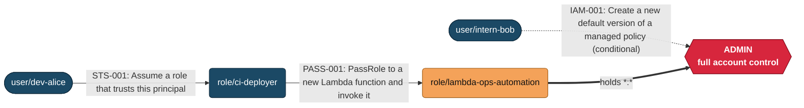

# iam-privesc-lens

**Offline AWS IAM privilege-escalation analyzer.** Feed it an IAM policy or a full
`aws iam get-account-authorization-details` export; it finds the paths a principal can use
to become administrator, explains every hop with the exact chain of AWS CLI calls an attacker
would make, and tells you how to break the chain.

```
user/dev-alice -> role/ci-deployer -> role/lambda-ops-automation => ADMIN
```

It is a defensive, read-only audit tool. Analysis never calls AWS.

## Why

Most IAM reviews look at one policy at a time. Real escalations rarely work like that.
A developer who can assume a CI role, where that CI role can pass *any* role to Lambda, and
where one Lambda execution role has `AdministratorAccess`, is an administrator. No single
policy in that chain looks alarming.

`iam-privesc-lens` treats the account as a graph. Principals are nodes. Edges are known
escalation techniques (`sts:AssumeRole`, `iam:PassRole` + a compute service,
`iam:CreateAccessKey` on another user, and so on). It then searches that graph for routes to
admin. I wrote it to answer the question I kept asking while designing least-privilege and
Zero Trust IAM boundaries: *"if this identity is compromised, how far can it actually get?"*

## Features

- **IAM evaluation semantics** for the subset that matters here: Allow/Deny with explicit-deny
  precedence, `Action`/`NotAction`, `Resource`/`NotResource`, `*` and `?` wildcards,
  case-insensitive action matching, string-or-list fields, `${aws:username}` policy variables
  and **permission boundaries**.
- **Condition-aware, not condition-blind.** Conditions are not evaluated. Anything that depends
  on one is reported as `conditional` and drawn as a dotted edge, so it is never silently
  treated as allowed.
- **26 privilege-escalation techniques** in a data-driven knowledge base. Each one has its required
  actions, severity, explanation, exploitation steps, remediation and references.
- **Multi-hop path search** over users, groups and roles, with a depth limit. Role trust policies
  are resolved (direct ARN, account root, `*`, service principals, explicit trust denies), and so are
  instance profiles and group membership.
- **Risky-permission checks** that are not escalations by themselves: `*:*`, `Allow` + `NotAction`,
  `s3:*` / `iam:*` on `*`, `iam:PassRole` on `*` or without `iam:PassedToService`,
  `secretsmanager:GetSecretValue` / `kms:Decrypt` on `*`, `sts:AssumeRole` on `*`, and role trust
  policies that admit `*` or a whole account.
- **Output formats:** a `rich` terminal view, JSON for pipelines, Markdown reports and **Mermaid**
  graphs that render natively on GitHub.
- **CI-friendly:** `--fail-on <severity>` returns exit status 1, and `--ignore-conditional` is there if you
  only want to gate on unconditional findings.
- Small footprint: the only runtime dependency is `rich`. `boto3` is optional and used only by `fetch`.

## Install

```bash
pip install git+https://github.com/aabhas1221/iam-privesc-lens
# optional, for the read-only `fetch` command:
pip install "iam-privesc-lens[aws] @ git+https://github.com/aabhas1221/iam-privesc-lens"
```

Requires Python 3.10+.

## Usage

```bash
# 1. Get an export (read-only; needs iam:GetAccountAuthorizationDetails)
aws iam get-account-authorization-details --output json > auth-details.json
#    or: iam-privesc-lens fetch -o auth-details.json [--profile audit]

# 2. Analyze the whole account, or start from one principal
iam-privesc-lens analyze auth-details.json
iam-privesc-lens analyze auth-details.json --principal dev-alice --details

# A single policy document works too
iam-privesc-lens analyze examples/policies/passrole-lambda.json

# Other formats
iam-privesc-lens analyze auth-details.json -f json -o report.json
iam-privesc-lens analyze auth-details.json -f markdown -o report.md
iam-privesc-lens analyze auth-details.json -f mermaid

# Browse the knowledge base
iam-privesc-lens techniques
iam-privesc-lens techniques PASS-001
```

### Example: a two-hop escalation

[`examples/vulnerable-account.json`](examples/vulnerable-account.json) is a synthetic export
for the fake account `123456789012`. `dev-alice` only has read access plus permission to assume
`ci-*` roles. Output captured from the tool:

```text
$ iam-privesc-lens analyze examples/vulnerable-account.json --principal dev-alice
╭────────────────────── iam-privesc-lens ───────────────────────╮
│ Source            examples/vulnerable-account.json            │
│ Mode              account (account 123456789012)              │
│ Principals        1                                           │
│ Admin-equivalent  none                                        │
│ Findings          1 critical  0 high  1 medium  0 low  0 info │
│ Escalation paths  1                                           │
╰───────────────────────────────────────────────────────────────╯

───────────────────────────────────────── Escalation paths ─────────────────────────────────────────
1. user/dev-alice -> role/ci-deployer -> role/lambda-ops-automation => ADMIN  confirmed
├── hop 1: user/dev-alice -> role/ci-deployer  [STS-001] Assume a role that trusts this principal
│   ├── why: trust policy of role/ci-deployer trusts the account root; sts:AssumeRole on it is 
│   │   allowed by DeveloperBase#AssumeCiRoles [Allow]
│   ├── exploitation
│   │   ├── aws sts assume-role --role-arn <role-arn> --role-session-name x
│   │   └── export the returned AccessKeyId / SecretAccessKey / SessionToken and continue as the 
│   │       role
│   └── fix: Trust specific principal ARNs rather than the account root, scope sts:AssumeRole in 
│       identity policies to the roles actually needed, and add conditions (MFA, source identity, 
│       ExternalId for third parties).
├── hop 2: role/ci-deployer -> role/lambda-ops-automation  [PASS-001] PassRole to a new Lambda 
│   function and invoke it
│   ├── why: role/lambda-ops-automation trusts lambda.amazonaws.com; iam:PassRole allowed on 
│   │   arn:aws:iam::123456789012:role/lambda-ops-automation
│   ├── exploitation
│   │   ├── zip f.zip index.py  # handler calls e.g. iam.attach_user_policy(UserName='<me>', 
│   │   │   PolicyArn=AdministratorAccess)
│   │   ├── aws lambda create-function --function-name x --runtime python3.12 --handler 
│   │   │   index.handler --zip-file fileb://f.zip --role <privileged-role-arn>
│   │   └── aws lambda invoke --function-name x out.json
│   └── fix: Scope iam:PassRole to the specific role ARNs the principal legitimately needs and add a
│       Condition on iam:PassedToService. Never allow PassRole on '*'. Ensure no privileged role 
│       trusts the service unless strictly required.
└── result: role/lambda-ops-automation has full administrator access

───────────────────────────────────────────── Findings ─────────────────────────────────────────────
┏━━━━━━━━━━┳━━━━━━━━━━━━━━━━┳━━━━━━━━━┳━━━━━━━━━━━━━━━━━━━━━━━━┳━━━━━━━━━━━┳━━━━━━━━━━━━━━━━━━━━━━━┓
┃ Severity ┃ Principal      ┃ ID      ┃ Finding                ┃ Status    ┃ Targets / evidence    ┃
┡━━━━━━━━━━╇━━━━━━━━━━━━━━━━╇━━━━━━━━━╇━━━━━━━━━━━━━━━━━━━━━━━━╇━━━━━━━━━━━╇━━━━━━━━━━━━━━━━━━━━━━━┩
│ CRITICAL │ user/dev-alice │ PATH    │ Escalation path to     │ confirmed │ user/dev-alice ->     │
│          │                │         │ admin in 2 hop(s)      │           │ role/ci-deployer ->   │
│          │                │         │                        │           │ role/lambda-ops-autom │
│          │                │         │                        │           │ ation => ADMIN        │
│ MEDIUM   │ user/dev-alice │ STS-001 │ Assume a role that     │ confirmed │ role/ci-deployer      │
│          │                │         │ trusts this principal  │           │                       │
└──────────┴────────────────┴─────────┴────────────────────────┴───────────┴───────────────────────┘
Run with --details for evidence, exploitation steps and remediation per finding.
```

### Escalation graph (generated with `-f mermaid` from the same example)

Solid edges are confirmed. Dotted edges are condition-gated: `intern-bob` can only rewrite his
policy when MFA is present.



The full-account run also reports `legacy-partner-access` (its trust policy allows `Principal: "*"`),
`svc-backup` (`s3:*` and `kms:Decrypt` on `*`) and the missing `iam:PassedToService` condition on
`ci-deployer`. It does **not** flag `ops-carol`: her group grants `iam:AttachUserPolicy` on `*`,
but her permissions boundary blocks it.

### JSON (excerpt)

```json
{
  "start": "user/dev-alice",
  "chain": "user/dev-alice -> role/ci-deployer -> role/lambda-ops-automation => ADMIN",
  "hops": 2,
  "conditional": false,
  "end_reason": "role/lambda-ops-automation has full administrator access",
  "edges": [
    {
      "source": "user/dev-alice",
      "target": "role/ci-deployer",
      "technique": "STS-001",
      "technique_name": "Assume a role that trusts this principal",
      "conditional": false,
      "detail": "trust policy of role/ci-deployer trusts the account root; sts:AssumeRole on it is allowed by DeveloperBase#AssumeCiRoles [Allow]",
      "assumption": ""
    }
  ]
}
```

## Techniques

| ID | Technique | Required actions | Severity | Gains |
|---|---|---|---|---|
| IAM-001 | Create a new default version of a managed policy | `iam:CreatePolicyVersion` | critical | admin |
| IAM-002 | Roll back to a more permissive policy version | `iam:SetDefaultPolicyVersion` | high | admin |
| IAM-003 | Attach a managed policy to a user | `iam:AttachUserPolicy` | critical | admin |
| IAM-004 | Attach a managed policy to a group | `iam:AttachGroupPolicy` | critical | admin |
| IAM-005 | Attach a managed policy to a role | `iam:AttachRolePolicy` | critical | admin |
| IAM-006 | Write an inline policy on a user | `iam:PutUserPolicy` | critical | admin |
| IAM-007 | Write an inline policy on a group | `iam:PutGroupPolicy` | critical | admin |
| IAM-008 | Write an inline policy on a role | `iam:PutRolePolicy` | critical | admin |
| IAM-009 | Add yourself to a privileged group | `iam:AddUserToGroup` | high | group |
| IAM-010 | Create access keys for another user | `iam:CreateAccessKey` | high | user |
| IAM-011 | Create a console password for another user | `iam:CreateLoginProfile` | high | user |
| IAM-012 | Reset another user's console password | `iam:UpdateLoginProfile` | high | user |
| IAM-013 | Rewrite a role trust policy and assume it | `iam:UpdateAssumeRolePolicy`, `sts:AssumeRole` | critical | role |
| STS-001 | Assume a role that trusts this principal | `sts:AssumeRole` | medium | role |
| PASS-001 | PassRole to a new Lambda function and invoke it | `iam:PassRole`, `lambda:CreateFunction`, `lambda:InvokeFunction` | high | role |
| PASS-002 | PassRole to a new Lambda function triggered by an event source | `iam:PassRole`, `lambda:CreateFunction`, `lambda:CreateEventSourceMapping` | high | role |
| PASS-003 | PassRole to a new EC2 instance | `iam:PassRole`, `ec2:RunInstances` | high | role |
| PASS-004 | PassRole to a new CloudFormation stack | `iam:PassRole`, `cloudformation:CreateStack` | high | role |
| PASS-005 | PassRole to a new Glue development endpoint | `iam:PassRole`, `glue:CreateDevEndpoint` | high | role |
| PASS-006 | PassRole to a new Data Pipeline | `iam:PassRole`, `datapipeline:CreatePipeline`, `datapipeline:PutPipelineDefinition`, `datapipeline:ActivatePipeline` | high | role |
| PASS-007 | PassRole to a new SageMaker notebook instance | `iam:PassRole`, `sagemaker:CreateNotebookInstance`, `sagemaker:CreatePresignedNotebookInstanceUrl` | high | role |
| PASS-008 | PassRole to a new CodeBuild project | `iam:PassRole`, `codebuild:CreateProject`, `codebuild:StartBuild` | high | role |
| LAM-001 | Overwrite the code of an existing Lambda function | `lambda:UpdateFunctionCode` | high | role |
| GLU-001 | Hijack an existing Glue development endpoint | `glue:UpdateDevEndpoint` | high | role |
| SSM-001 | Run commands on EC2 instances through Systems Manager | `ssm:SendCommand or ssm:StartSession` | high | role |
| EC2-001 | Push an SSH key with EC2 Instance Connect | `ec2-instance-connect:SendSSHPublicKey` | high | role |

`Gains` describes what the attacker ends up controlling. `admin` means the principal can grant itself
arbitrary permissions. `user`, `role` and `group` mean it can act as, or join, another principal. In
account mode those targets are resolved, which is what makes multi-hop paths possible. Run
`iam-privesc-lens techniques <ID>` for the explanation, exploitation steps, remediation and references.

## How it works

1. **Load.** Users, groups, roles, managed policies (default version), inline policies, permission
   boundaries, trust policies and instance profiles are resolved from the export. Group policies are
   merged into each member's effective policy set.
2. **Evaluate.** Every check asks either "is this action allowed on *this* ARN?" or "is it allowed on
   *at least one* resource?". The decision is `allowed`, `conditional`, `denied` or `implicit_deny`,
   and it records the statements that produced it as evidence.
3. **Build edges.** For each principal and technique, the analyzer resolves concrete targets. Examples:
   roles whose trust policy admits `lambda.amazonaws.com` *and* fall inside the principal's
   `iam:PassRole` resource scope, or users covered by its `iam:CreateAccessKey` scope.
   Policy-write techniques (`iam:PutUserPolicy` and similar) only become an admin edge when the
   resource scope includes something the principal controls: itself, its groups, a role it can
   assume, or a managed policy attached to it.
4. **Search.** A depth-limited DFS (`--max-depth`, default 4) finds routes to a node that holds
   `*:*` or can grant itself anything. Paths are ranked confirmed-first and then by length.

## CI usage

The repo does not ship a workflow file. This snippet is a starting point for GitHub Actions; it assumes the
export is produced by an earlier, separately authorised read-only step:

```yaml
- name: IAM privilege-escalation gate
  run: |
    pip install git+https://github.com/aabhas1221/iam-privesc-lens
    iam-privesc-lens analyze auth-details.json -f markdown -o iam-report.md --fail-on high --ignore-conditional
- uses: actions/upload-artifact@v4
  if: always()
  with:
    name: iam-report
    path: iam-report.md
```

You can also gate IaC changes by running it against individual policy documents rendered from
Terraform or CloudFormation before they are applied.

## Limitations

These are deliberate scope choices. Please read them before trusting a clean result:

- **Conditions are not evaluated.** Condition-gated grants are flagged `conditional`, not resolved.
- **No SCPs, RCPs, session policies or resource-based policies** (S3 bucket policies, KMS key
  policies, Lambda resource policies) are considered. The one exception is role trust policies. An SCP may block a reported path, and
  a resource policy may open one that is not reported.
- **No cross-account graph.** Trust in other accounts is reported, but those accounts are not traversed.
- **Resource existence is inferred.** Some techniques need an existing resource, for example a Lambda function or
  EC2 instance running as the target role. Those edges carry an explicit `assumption`.
- **Group hops are approximated.** After `iam:AddUserToGroup` the analysis continues with the group's
  own policies, not the union of user and group permissions.
- When an export references an AWS-managed policy without its document, a small built-in approximation is used
  for `AdministratorAccess`, `IAMFullAccess`, `PowerUserAccess` and `ReadOnlyAccess`. Other missing
  policies produce a warning.
- The knowledge base covers well-known techniques, not every AWS service.

## Roadmap

- Service control policies and resource-based policies (S3, KMS, Lambda, SNS/SQS)
- Condition evaluation for common keys (`aws:MultiFactorAuthPresent`, `iam:PassedToService`, `aws:PrincipalTag`)
- Cross-account trust graph across multiple exports
- More techniques (ECS/EKS task roles, Step Functions, App Runner, `iam:CreateRole` chains)
- SARIF output for code-scanning integrations
- Diffing two exports to show escalation paths introduced by a change

## Development

```bash
python -m venv .venv && . .venv/bin/activate
pip install -e ".[dev]"
pytest
```

See [CONTRIBUTING.md](CONTRIBUTING.md). Adding a technique means one entry in
`src/iam_privesc_lens/techniques.py` and one test case.

## Disclaimer

Use this tool only on AWS accounts you own or are explicitly authorised to audit. The exploitation steps
explain *why* a finding matters and how to verify it in an authorised assessment. They are not an
invitation to use them anywhere else. Analysis is entirely offline. The optional `fetch` command makes a
single read-only API call (`iam:GetAccountAuthorizationDetails`).

The example account and every identifier in this repository are synthetic.

## License

[MIT](LICENSE) © 2026 Aabhas Pandey
